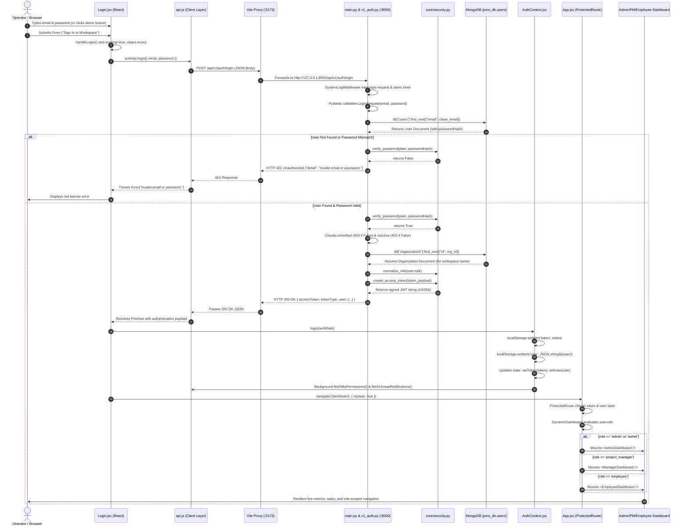

# WAYMARK PMS — Complete Authentication & Role-Based Dashboard Access Technical Guide

> **Author**: Senior Backend Engineer & Software Architect  
> **Target Audience**: Full-Stack Developers, Security Auditors, and Computer Science Students  
> **Project**: WAYMARK Multi-Tenant Project Management System (PMS)  
> **Repository Base**: `c:\Users\User\Desktop\pmsauth`  
> **Status**: Verified against Active Codebase (Git Branch: `feature/auth`)  

---

## Table of Contents

1. [Executive Summary & Architecture Blueprint](#1-executive-summary--architecture-blueprint)
2. [Phase 1: Codebase Reality Inspection](#phase-1-codebase-reality-inspection)
3. [Phase 2: End-to-End Login Lifecycle (Chronological Trace)](#phase-2-end-to-end-login-lifecycle-chronological-trace)
4. [Phase 3: File-by-File Technical Deep Dive](#phase-3-file-by-file-technical-deep-dive)
5. [Phase 4: Core Engineering Concepts Illustrated by Real Code](#phase-4-core-engineering-concepts-illustrated-by-real-code)
6. [Phase 5: Role-Based Access Control (RBAC) & Perimeter Analysis](#phase-5-role-based-access-control-rbac--perimeter-analysis)
7. [Phase 6: Security and Architecture Audit](#phase-6-security-and-architecture-audit)
8. [Phase 7: Comprehensive Troubleshooting & Debugging Runbook](#phase-7-comprehensive-troubleshooting--debugging-runbook)
9. [Phase 8: Student & Junior Engineer Learning Companion](#phase-8-student--junior-engineer-learning-companion)
10. [Task 2 Guidance: GitHub Fork, Push & Pull Request Workflow](#task-2-guidance-github-fork-push--pull-request-workflow)

---

## 1. Executive Summary & Architecture Blueprint

The WAYMARK Project Management System provides a multi-tenant, role-segregated platform for corporate software engineering teams. Access control is divided into three distinct organizational tiers:

1. **Administrator (Workspace Owner)**: Configures global workspace settings, registers staff, oversees all database collections, and monitors 24-hour auto-purged terminal audit logs.
2. **Project Manager (Head of Projects)**: Creates project delivery roadmaps, configures Kanban workflow columns, balances engineering workload, and approves deliverables.
3. **Employee (Staff Engineer)**: Works through prioritized task backlogs, submits Pull Request / Dockerfile deliverables for approval, and schedules collaboration meetings.

### High-Level Topology

```
+---------------------------------------------------------------------------------------+
|                                    CLIENT BROWSER                                     |
|                                                                                       |
|   React 19 Single Page App (SPA)  <--------->  React Context (AuthContext)            |
|   - Login.jsx Form UI                          - Token in localStorage                |
|   - ProtectedRoute Guard                       - Sanitized User in localStorage       |
|   - DynamicDashboard Dispatcher                - Client-side Permission Cache         |
+---------------------------------------------------------------------------------------+
                                          |
               HTTP Requests: Bearer JWT  |  Proxy: /api -> :8000
                                          v
+---------------------------------------------------------------------------------------+
|                                  LOCAL DEV REVERSE PROXY                              |
|                              Vite 8.3 Dev Server (Port 5173)                          |
+---------------------------------------------------------------------------------------+
                                          |
               Reverse Proxied HTTP       |  http://127.0.0.1:8000/api/v1
                                          v
+---------------------------------------------------------------------------------------+
|                                 FASTAPI APPLICATION CORE                              |
|                                Uvicorn ASGI Server (:8000)                            |
|                                                                                       |
|  [CORSMiddleware] -> [SystemLogMiddleware] -> [FastAPI Router Engine]                 |
|                                                        |                              |
|         +----------------------------------------------+                              |
|         v                                              v                              |
|   v1_auth.py (/api/v1/auth)                     v1_rbac.py (/api/v1/rbac)             |
|   - POST /login (Bcrypt + JWT Issue)            - GET /my-permissions                 |
|   - GET  /me    (Token Hydration)               - GET /staff (Admin Invisibility)     |
|   - POST /logout (Session Revoke)               - GET /roles & /permissions           |
+---------------------------------------------------------------------------------------+
            |                                                    |
   Async Motor Driver                                   Async Motor Driver
   mongodb://localhost:27017                            mongodb://localhost:27017
            v                                                    v
+---------------------------------------------------------------------------------------+
|                                  DATABASE LAYER (MONGODB)                             |
|                                     Database: `pms_db`                                |
|                                                                                       |
|   Collections:                                                                        |
|   - `users`: User profiles, bcrypt hashes, roles, employee IDs, verification flags    |
|   - `organizations`: Multi-tenant organization records, plans, activation flags       |
|   - `roles`: Tenant role definitions                                                  |
|   - `permissions`: Granular action keys (e.g. project:create, task:submit)            |
|   - `role_permissions`: Mapping tables between role IDs and permission IDs            |
|   - `system_logs`: Real-time HTTP audit records (TTL auto-purged after 24 hours)       |
+---------------------------------------------------------------------------------------+
```

---

## Phase 1: Codebase Reality Inspection

Every statement in this report has been verified against the physical source code on disk.

### 1.1 Technical Stack Inventory

| Component | Physical Technology | Specific Version in Project | Evidence Source |
|---|---|---|---|
| **Frontend Framework** | React (SPA) | `^19.2.8` | `pms_frontend/package.json` |
| **Frontend Tooling** | Vite | `^8.3.0` | `pms_frontend/package.json` |
| **Client Router** | React Router DOM | `^7.18.3` | `pms_frontend/package.json` |
| **Frontend Styling** | Tailwind CSS v4 + Liquid Glassmorphism | `@tailwindcss/vite ^4.3.3` | `pms_frontend/src/index.css` |
| **Backend Framework** | FastAPI (Python ASGI) | Python 3.14.6 + FastAPI 0.115+ | `pms_backend/venv/pyvenv.cfg` |
| **ASGI Server** | Uvicorn | `uvicorn[standard]` | `pms_backend/requirements.txt` |
| **Database Engine** | MongoDB Community Server | Local port `27017` | Windows Service `MongoDB` |
| **Database Driver** | Motor (AsyncIO MongoDB Driver) | `motor` (coroutine-based) | `pms_backend/core/database.py` |
| **Password Hashing** | Bcrypt (Blowfish-based key derivation) | `bcrypt` (12 salt rounds) | `pms_backend/core/security.py` |
| **Token Standard** | Signed JSON Web Tokens (PyJWT) | `pyjwt` with HMAC-SHA256 (`HS256`) | `pms_backend/core/security.py` |

### 1.2 Database Technology & Connection Topology

Connection parameters are defined in `pms_backend/core/database.py`:
- **Driver**: `motor.motor_asyncio.AsyncIOMotorClient`.
- **Connection URI**: Loaded via `os.getenv("MONGO_URI")` with default fallback to `"mongodb://localhost:27017"`.
- **Database Name**: Loaded via `os.getenv("DB_NAME")` with fallback to `"project_management_system"`. The active `.env` file explicitly configures `DB_NAME=pms_db`.
- **SSL/TLS Handling**: If the URI contains `mongodb+srv://`, `tls=true`, or `ssl=true`, `certifi.where()` is supplied via `client_kwargs["tlsCAFile"]`.
- **Dependency Injection**: `get_db()` returns the active Motor database handle `db`.
- **Database Lifespan**: `init_db()` is called inside `main.py`'s `@asynccontextmanager def lifespan(app: FastAPI)` hook, ensuring indexes are built prior to servicing incoming HTTP requests.

### 1.3 User Schema & Physical Document Structure

User documents reside in the MongoDB `users` collection. A physical document stored in `pms_db.users` contains the following fields:

```json
{
  "_id": {"$oid": "60549730faee4d50bc96e7ba"},
  "id": "60549730-faee-4d50-bc96-e7ba4147d047",
  "organizationId": "org-demo-1234",
  "email": "admin@waymark.com",
  "name": "Alex Rivera (Admin)",
  "role": "admin",
  "employeeId": "EMP-1000",
  "position": "Workspace Owner / Administrator",
  "passwordHash": "$2b$12$KIXeWq1i9y...",
  "otp": "839201",
  "isVerified": true,
  "isActive": true,
  "avatarUrl": "https://...",
  "createdAt": "2026-10-26T06:05:39.123Z"
}
```

#### Field Responsibilities
- `_id`: Native MongoDB BSON ObjectId. Stripped prior to JSON responses via `user.pop("_id", None)`.
- `id`: Canonical UUIDv4 string generated on user registration. Used as the foreign key in JWT claims (`sub`, `userId`), tasks, and audit logs.
- `organizationId`: UUIDv4 string referencing `organizations.id`. Enforces multi-tenant data partitioning.
- `email`: Normalized, lowercased user email address used as the primary login identifier.
- `name`: User's full display name.
- `role`: Canonical access string (`admin`, `project_manager`, `employee`, `owner`, `member`, `guest`).
- `employeeId`: Sequential identifier (e.g., `EMP-1001`) used for organizational HR tracking.
- `position`: Job title (e.g., "Lead PM", "Full Stack Engineer").
- `passwordHash`: Salted 60-character Bcrypt hash. Never returned across any API endpoint.
- `otp`: Ephemeral 6-digit verification code generated during workspace registration.
- `isVerified`: Boolean flag. `false` prevents login until the 6-digit OTP code is confirmed.
- `isActive`: Boolean flag. `false` indicates administrative deactivation.
- `createdAt`: UTC datetime timestamp.

---

## Phase 2: End-to-End Login Lifecycle (Chronological Trace)

The following sequence details every operation executed when an operator signs into WAYMARK.



### Detailed Chronological Step Breakdown

#### Step 1: User Initiation & UI Form State
- **Trigger**: The user accesses `http://localhost:5173/login`.
- **Executing Component**: `pms_frontend/src/pages/Login.jsx`.
- **Data in**: User enters credentials or clicks a demo card (`fillDemoCredentials('admin')`).
- **Processing**: Component updates internal React state variables `email` and `password`.
- **Database/Network Action**: None.

#### Step 2: Form Submission & Validation
- **Trigger**: User clicks "Sign In to Workspace" or presses Enter within the form.
- **Executing Function**: `handleLogin(e)` in `Login.jsx`.
- **Data in**: Synthetic Form Event `e`.
- **Processing**: Calls `e.preventDefault()` to stop native browser page reload. Sets `loading(true)` and `error(null)`.
- **Next Step**: Invokes `authApi.login({ email, password })`.

#### Step 3: Network Dispatch Through Centralized API Client
- **Trigger**: Invocation of `authApi.login()`.
- **Executing File**: `pms_frontend/src/services/api.js`.
- **Data in**: Object `{ email: "admin@waymark.com", password: "Password123!" }`.
- **Processing**: `apiCall('/auth/login', options)` inspects the endpoint:
  - Assembles absolute URL: `${BASE_URL}/auth/login` (evaluates to `/api/v1/auth/login`).
  - Sets HTTP Header: `Content-Type: application/json`.
  - Serializes JavaScript object into JSON string via `JSON.stringify(body)`.
  - Calls native browser `window.fetch()`.

#### Step 4: Vite Reverse Proxy Forwarding
- **Trigger**: Browser dispatches HTTP POST to origin `http://localhost:5173/api/v1/auth/login`.
- **Executing File**: `pms_frontend/vite.config.js`.
- **Processing**: The dev server inspects matching rules:
  ```javascript
  server: {
    proxy: {
      '/api': {
        target: 'http://127.0.0.1:8000',
        changeOrigin: true
      }
    }
  }
  ```
  Vite forwards the raw TCP stream directly to FastAPI on port 8000. This eliminates browser CORS preflight restrictions and cross-domain cookie/header blocks.

#### Step 5: Backend Request Ingestion & Middleware Execution
- **Trigger**: Inbound HTTP connection on port `8000`.
- **Executing File**: `pms_backend/main.py`.
- **Processing**:
  - `CORSMiddleware` validates that the origin (`http://localhost:5173`) matches `allow_origins` or `allow_origin_regex`.
  - `SystemLogMiddleware` records start time (`time.time()`), intercepts the call, and sets up post-request response duration logging into `pms_db.system_logs`.
  - FastAPI matches the route URL `/api/v1/auth/login` to `v1_auth.py`.

#### Step 6: Pydantic Schema Validation
- **Executing Function**: `login(payload: LoginRequest, db = Depends(get_db))` in `pms_backend/api/routers/v1_auth.py`.
- **Data in**: Inbound JSON payload parsed into `LoginRequest`:
  ```python
  class LoginRequest(BaseModel):
      email: EmailStr
      password: str = Field(..., min_length=1)
  ```
- **Failure Condition**: If email format is malformed or password is empty, FastAPI raises an automatic `422 Unprocessable Entity` validation error handled by `core.exceptions.validation_exception_handler`.

#### Step 7: Database User Lookup
- **Executing File**: `pms_backend/api/routers/v1_auth.py`.
- **Processing**:
  ```python
  clean_email = payload.email.strip().lower()
  user = await db["users"].find_one({"email": clean_email})
  ```
- **Database Query**: Asynchronous BSON query to MongoDB collection `users` targeting index `{"email": 1}`.
- **Data Returned**: Complete MongoDB document containing `passwordHash`, `role`, `isVerified`, and `isActive`.

#### Step 8: Cryptographic Password Verification
- **Executing File**: `pms_backend/core/security.py`.
- **Executing Function**: `verify_password(payload.password, user.get("passwordHash", ""))`.
- **Processing**:
  ```python
  bcrypt.checkpw(plain_password.encode("utf-8"), hashed_password.encode("utf-8"))
  ```
  Bcrypt extracts the 128-bit salt embedded in the stored modular crypt format string, runs the key derivation algorithm against the plain password, and compares output bytes in constant time.
- **Failure Condition**: If `user` is `None` or `checkpw()` evaluates to `False`, the backend immediately raises:
  ```python
  raise HTTPException(
      status_code=status.HTTP_401_UNAUTHORIZED,
      detail="Invalid email or password.",
      headers={"WWW-Authenticate": "Bearer"},
  )
  ```
  *Security Note*: The error detail deliberately does not state whether the email or the password was the invalid component, guarding against account enumeration attacks.

#### Step 9: Account State Verification
- **Executing File**: `pms_backend/api/routers/v1_auth.py`.
- **Processing**:
  - **Email Verification Gate**:
    ```python
    if not user.get("isVerified", False):
        raise HTTPException(
            status_code=status.HTTP_403_FORBIDDEN,
            detail="Account not verified. Please verify your OTP to continue.",
        )
    ```
  - **Deactivation Gate**:
    ```python
    if not user.get("isActive", True):
        raise HTTPException(
            status_code=status.HTTP_403_FORBIDDEN,
            detail="Your account has been deactivated. Please contact your organization administrator.",
        )
    ```

#### Step 10: Multi-Tenant Context Resolution & Role Normalization
- **Executing File**: `pms_backend/api/routers/v1_auth.py` and `pms_backend/core/security.py`.
- **Processing**:
  - Resolves organization name: `org_doc = await db["organizations"].find_one({"id": org_id})`.
  - Normalizes role string: `normalize_role(user.get("role", "employee"))` converts variants like `"Administrator"` or `"PM"` to canonical identifiers (`"admin"`, `"project_manager"`).

#### Step 11: Cryptographic JWT Minting
- **Executing Function**: `create_access_token(data=token_payload)` in `pms_backend/core/security.py`.
- **Processing**:
  - Claims Assembly:
    ```python
    token_payload = {
        "userId": user["id"],
        "sub": user["id"],
        "organizationId": org_id or "",
        "role": normalized_user_role,
        "email": user["email"],
        "name": user.get("name", ""),
        "iat": datetime.now(timezone.utc),
        "exp": datetime.now(timezone.utc) + timedelta(hours=24)
    }
    ```
  - Signature: `jwt.encode(to_encode, SECRET_KEY, algorithm="HS256")`.
  - Secret Key: Loaded from `os.getenv("JWT_SECRET")`.

#### Step 12: Backend HTTP 200 Response
- **Returned Payload**:
  ```json
  {
    "accessToken": "eyJhbGciOiJIUzI1NiIsInR5cCI6IkpXVCJ...",
    "tokenType": "bearer",
    "user": {
      "id": "60549730-faee-4d50-bc96-e7ba4147d047",
      "name": "Alex Rivera (Admin)",
      "email": "admin@waymark.com",
      "role": "admin",
      "organizationId": "org-demo-1234",
      "organizationName": "Waymark Tech Corp",
      "employeeId": "EMP-1000",
      "position": "Workspace Owner / Administrator",
      "avatarUrl": null
    }
  }
  ```

#### Step 13: Client-Side State Hydration & Storage
- **Executing Function**: `login(authData)` in `pms_frontend/src/context/AuthContext.jsx`.
- **Processing**:
  - Extracts `accessToken = authData.accessToken`.
  - Normalizes user role: `normalizeRoleName(rawUser.role)`.
  - Persists session to browser storage:
    ```javascript
    localStorage.setItem('token', accessToken);
    localStorage.setItem('user', JSON.stringify(normalizedUser));
    ```
  - Sets reactive state: `setToken(accessToken)`, `setUser(normalizedUser)`.
  - Triggers non-blocking background synchronization:
    - `fetchMyPermissions()`: Issues `GET /api/v1/rbac/my-permissions`. For admins, yields `['*']`.
    - `fetchUnreadNotifications()`: Issues `GET /api/v1/notifications/unread-count`.

#### Step 14: Client Route Navigation
- **Executing File**: `pms_frontend/src/pages/Login.jsx`.
- **Processing**: `navigate(destination, { replace: true })` runs, routing the browser history to `/dashboard`.

#### Step 15: Dynamic Dashboard Dispatch
- **Executing File**: `pms_frontend/src/App.jsx`.
- **Processing**:
  - Route `/dashboard` is protected:
    ```jsx
    <Route path="/dashboard" element={<ProtectedRoute><DynamicDashboard /></ProtectedRoute>} />
    ```
  - `<ProtectedRoute>` verifies `user` and `token` are non-null.
  - `<DynamicDashboard>` inspects `user.role`:
    - `admin` or `owner` $\rightarrow$ Mounts `<AdminDashboard />`.
    - `project_manager` $\rightarrow$ Mounts `<ManagerDashboard />`.
    - `employee` $\rightarrow$ Mounts `<EmployeeDashboard />`.
- **Result**: The user views their role-specific dashboard with live database data.

---

## Phase 3: File-by-File Technical Deep Dive

### 3.1 `pms_frontend/src/pages/Login.jsx`
- **Path**: `c:\Users\User\Desktop\pmsauth\pms_frontend\src\pages\Login.jsx`
- **Responsibility**: Authenticated user interface. Renders the login card, registration form, OTP activation screen, and instant demo credentials buttons.
- **Key Imports**:
  - `useAuth` from `../context/AuthContext`: Consumes the global authentication store.
  - `authApi` from `../services/api`: Network interface for login, signup, and OTP requests.
  - `useNavigate, useLocation` from `react-router-dom`: Controls client-side redirection.

```javascript
// Line 80-99 of Login.jsx
const handleLogin = async (e) => {
  e.preventDefault();
  setError(null);
  setSuccessMessage(null);

  try {
    setLoading(true);
    const res = await authApi.login({ email, password });
    login(res);
    navigate(destination, { replace: true });
  } catch (err) {
    const msg = err.message || 'Login failed';
    if (msg.toLowerCase().includes('not verified') || msg.toLowerCase().includes('otp')) {
      setMode('verify_otp');
      setError('Your administrator account is pending verification. Enter the 6-digit OTP code.');
    } else {
      setError(msg);
    }
  } finally {
    setLoading(false);
  }
};
```
*Line-by-Line Breakdown*:
- `e.preventDefault()`: Stops standard HTML form submission which would otherwise refresh the page and dump application state.
- `setError(null)`: Resets previous error states so stale alerts disappear.
- `const res = await authApi.login(...)`: Halts execution until the server returns or rejects.
- `login(res)`: Passes the response payload to React Context, storing credentials in `localStorage`.
- `catch (err)`: Inspects error text. If the backend responded with HTTP 403 Unverified, automatically flips UI `mode` to `'verify_otp'`, displaying the 6-digit PIN input.

---

### 3.2 `pms_frontend/src/services/api.js`
- **Path**: `c:\Users\User\Desktop\pmsauth\pms_frontend\src\services\api.js`
- **Responsibility**: Centralized HTTP client wrapper. Manages base URL resolution, Bearer token injection, request header formatting, and standard error decoding.

```javascript
// Line 7-36 of api.js
const BASE_URL = import.meta.env.VITE_API_BASE_URL || (
  import.meta.env.PROD 
    ? 'https://proman-aura-backend-362935833196.asia-south1.run.app/api/v1' 
    : '/api/v1'
);

export async function apiCall(endpoint, options = {}) {
  const token = localStorage.getItem('token');
  const isFormData = options.body instanceof FormData;
  
  const headers = {
    ...(token && { 'Authorization': `Bearer ${token}` }),
    ...(!isFormData && { 'Content-Type': 'application/json' }),
    ...options.headers,
  };

  let body = options.body;
  if (body && !isFormData && typeof body === 'object') {
    body = JSON.stringify(body);
  }

  const response = await fetch(`${BASE_URL}${endpoint}`, {
    ...options,
    headers,
    body,
  });
```
*Line-by-Line Breakdown*:
- `const BASE_URL`: In development, sets the root to `/api/v1` so Vite proxies requests locally. In production, points to the Cloud Run deployment.
- `const token = localStorage.getItem('token')`: Inspects browser storage for an active JWT.
- `...(token && { 'Authorization': Bearer ${token} })`: Spread operator conditionally attaches the Bearer token to headers if present.
- `body = JSON.stringify(body)`: Automatically serializes JavaScript objects to standard JSON text.

---

### 3.3 `pms_frontend/src/context/AuthContext.jsx`
- **Path**: `c:\Users\User\Desktop\pmsauth\pms_frontend\src\context\AuthContext.jsx`
- **Responsibility**: Global state engine for user identity, role permissions, and route guards.
- **Key Functions**:
  - `AuthProvider`: React Context provider wrapping the application component tree.
  - `verifySession()`: Runs on initial page load; validates persisted tokens against `/api/v1/auth/me`.
  - `ProtectedRoute`: Higher-Order Component preventing unauthenticated access to restricted URLs.

```javascript
// Line 128-146 of AuthContext.jsx
const login = (authData) => {
  const accessToken = authData.accessToken || authData.access_token;
  const rawUser = authData.user || {};
  const normalizedUser = {
    ...rawUser,
    role: normalizeRoleName(rawUser.role),
  };

  localStorage.setItem('token', accessToken);
  localStorage.setItem('user', JSON.stringify(normalizedUser));

  setToken(accessToken);
  setUser(normalizedUser);

  fetchMyPermissions();
  fetchUnreadNotifications();
};
```
*Line-by-Line Breakdown*:
- `authData.accessToken`: Accommodates camelCase (`accessToken`) and snake_case (`access_token`) backend conventions.
- `normalizeRoleName`: Sanitizes strings (e.g. converting "PM" or "project-manager" into "project_manager") to avoid broken permission checks.
- `localStorage.setItem(...)`: Writes identity to client disk so the session survives page reloads.
- `fetchMyPermissions()`: Asynchronously updates capability permissions from the database.

---

### 3.4 `pms_frontend/src/App.jsx`
- **Path**: `c:\Users\User\Desktop\pmsauth\pms_frontend\src\App.jsx`
- **Responsibility**: Top-level route definition, dynamic role branching, and application shell layout.

```javascript
// Line 21-32 of App.jsx
const DynamicDashboard = () => {
  const { user } = useAuth();
  if (!user) return <Navigate to="/login" replace />;

  if (user.role === 'admin' || user.role === 'owner') {
    return <AdminDashboard />;
  }
  if (user.role === 'project_manager') {
    return <ManagerDashboard />;
  }
  return <EmployeeDashboard />;
};
```
*Line-by-Line Breakdown*:
- `const { user } = useAuth()`: Subscribes to the active user state.
- `if (!user)`: Safety redirect back to `/login` if state is empty.
- Multi-tier `if` statements: Dispatches the exact component hierarchy matching the authenticated role.

---

### 3.5 `pms_backend/core/database.py`
- **Path**: `c:\Users\User\Desktop\pmsauth\pms_backend\core\database.py`
- **Responsibility**: Establishes the asynchronous Motor MongoDB client connection and initializes database collection indexes and Time-To-Live (TTL) expiration rules.

```python
# Line 11-19 of database.py
MONGO_URI = os.getenv("MONGO_URI") or "mongodb://localhost:27017"
DB_NAME = os.getenv("DB_NAME") or "project_management_system"

client_kwargs = {}
if "mongodb+srv://" in MONGO_URI or "tls=true" in MONGO_URI.lower():
    client_kwargs["tlsCAFile"] = certifi.where()

client = AsyncIOMotorClient(MONGO_URI, **client_kwargs)
db = client[DB_NAME]
```
*Line-by-Line Breakdown*:
- `AsyncIOMotorClient`: Creates a non-blocking MongoDB connection pool integrated with Python's `asyncio` event loop.
- `certifi.where()`: Supplies updated Mozilla CA root certificates when connecting to TLS-secured clusters (e.g., MongoDB Atlas).
- `db = client[DB_NAME]`: Exposes the database handle to application routers.

---

### 3.6 `pms_backend/core/security.py`
- **Path**: `c:\Users\User\Desktop\pmsauth\pms_backend\core\security.py`
- **Responsibility**: Cryptographic hashing, verification, token generation, user hydration, and FastAPI RBAC dependency factories.

```python
# Line 33-56 of security.py
def hash_password(password: str) -> str:
    if not password:
        raise ValueError("Password cannot be empty.")
    salt = bcrypt.gensalt(rounds=12)
    return bcrypt.hashpw(password.encode("utf-8"), salt).decode("utf-8")

def verify_password(plain_password: str, hashed_password: str) -> bool:
    if not plain_password or not hashed_password:
        return False
    try:
        return bcrypt.checkpw(
            plain_password.encode("utf-8"),
            hashed_password.encode("utf-8")
        )
    except Exception:
        return False
```
*Line-by-Line Breakdown*:
- `bcrypt.gensalt(rounds=12)`: Generates a cryptographically strong 128-bit random salt with a cost factor of $2^{12} = 4096$ key expansion iterations.
- `bcrypt.hashpw(...)`: Produces a modular crypt string (e.g., `$2b$12$...`) containing the algorithm identifier, cost factor, salt, and hash.
- `bcrypt.checkpw(...)`: Computes the candidate hash using the salt extracted from `hashed_password` and checks equivalence in constant time.

```python
# Line 118-153 of security.py
async def get_current_user(
    credentials: HTTPAuthorizationCredentials = Depends(oauth2_scheme),
    db = Depends(get_db)
) -> Dict[str, Any]:
    token = credentials.credentials
    payload = decode_access_token(token)
    
    user_id = payload.get("userId") or payload.get("sub")
    if not user_id:
        raise HTTPException(
            status_code=status.HTTP_401_UNAUTHORIZED,
            detail="Token payload is missing user identification.",
        )

    user = await db["users"].find_one({"id": str(user_id)})
    if not user:
        raise HTTPException(
            status_code=status.HTTP_401_UNAUTHORIZED,
            detail="User account associated with this token no longer exists.",
        )

    if not user.get("isActive", True):
        raise HTTPException(
            status_code=status.HTTP_403_FORBIDDEN,
            detail="User account is deactivated.",
        )

    user.pop("_id", None)
    return user
```
*Line-by-Line Breakdown*:
- `Depends(oauth2_scheme)`: Extracts the `Authorization: Bearer <token>` string from inbound HTTP request headers.
- `decode_access_token(token)`: Validates signature and expiration timestamp (`exp`).
- `db["users"].find_one({"id": str(user_id)})`: Hydrates the full, fresh user profile from MongoDB on every authenticated request. This guarantees that if a user is deleted or deactivated, their existing JWT is rejected immediately.
- `user.pop("_id", None)`: Deletes MongoDB's BSON `_id` to prevent JSON serialization errors.

---

### 3.7 `pms_backend/api/routers/v1_auth.py`
- **Path**: `c:\Users\User\Desktop\pmsauth\pms_backend\api\routers\v1_auth.py`
- **Responsibility**: Authentication endpoints for workspace signup, OTP verification, login, profile introspection (`/me`), and logout.

```python
# Line 291-340 of v1_auth.py
@router.post("/login", status_code=status.HTTP_200_OK)
async def login(payload: LoginRequest, db = Depends(get_db)):
    clean_email = payload.email.strip().lower()
    user = await db["users"].find_one({"email": clean_email})

    if not user or not verify_password(payload.password, user.get("passwordHash", "")):
        raise HTTPException(
            status_code=status.HTTP_401_UNAUTHORIZED,
            detail="Invalid email or password.",
            headers={"WWW-Authenticate": "Bearer"},
        )

    if not user.get("isVerified", False):
        raise HTTPException(status_code=403, detail="Account not verified.")

    if not user.get("isActive", True):
        raise HTTPException(status_code=403, detail="Your account has been deactivated.")

    org_id = user.get("organizationId")
    normalized_user_role = normalize_role(user.get("role", "employee"))

    token_payload = {
        "userId": user["id"],
        "organizationId": org_id or "",
        "role": normalized_user_role,
        "email": user["email"],
        "name": user.get("name", "")
    }
    access_token = create_access_token(data=token_payload)

    return {
        "accessToken": access_token,
        "tokenType": "bearer",
        "user": { ... }
    }
```
*Line-by-Line Breakdown*:
- `clean_email`: Normalizes email to prevent case-sensitivity login failures (e.g. `User@Waymark.com` vs `user@waymark.com`).
- `verify_password(...)`: Validates credentials against stored Bcrypt hash.
- `token_payload`: Encodes tenant context (`organizationId`) and role claims (`role`) directly into the cryptographically signed JWT.

---

## Phase 4: Core Engineering Concepts Illustrated by Real Code

### 4.1 Frontend vs Backend
- **Concept**: The **frontend** runs on the client device (inside Google Chrome, Safari, etc.) and controls user interactions, animations, and DOM rendering. The **backend** runs on a remote or local web server, controlling database transactions, cryptographic operations, and core business rules.
- **In Your Code**:
  - Frontend: `pms_frontend/src/pages/Login.jsx` executes inside the user's browser, compiling JSX into interactive HTML/CSS elements.
  - Backend: `pms_backend/api/routers/v1_auth.py` executes on the server runtime, directly accessing the local file system and MongoDB socket.

### 4.2 Client-Server Architecture
- **Concept**: A distributed computing topology separating resource requesters (Clients) from centralized service providers (Servers). Communication occurs over standard network protocols.
- **In Your Code**: The React client runs on `http://localhost:5173`. The FastAPI server runs on `http://127.0.0.1:8000`. They operate as independent operating system processes communicating via TCP network sockets.

### 4.3 HTTP Requests and Responses
- **Concept**: The stateless application-level protocol governing the web. The client issues an **HTTP Request** specifying a method and resource path; the server replies with an **HTTP Response** containing a status code and body.
- **In Your Code**: `apiCall()` in `pms_frontend/src/services/api.js` constructs an HTTP Request:
  ```http
  POST /api/v1/auth/login HTTP/1.1
  Host: localhost:5173
  Content-Type: application/json

  {"email":"admin@waymark.com","password":"Password123!"}
  ```
  FastAPI returns an HTTP Response:
  ```http
  HTTP/1.1 200 OK
  Content-Type: application/json

  {"accessToken":"eyJhbGci...","tokenType":"bearer","user":{...}}
  ```

### 4.4 API Endpoints and REST APIs
- **Concept**: An API endpoint is a specific URI where a service can be accessed by client software. REST (Representational State Transfer) organizes endpoints by resource nouns, utilizing standard HTTP verbs.
- **In Your Code**: In `pms_backend/api/routers/v1_auth.py`, `@router.post("/login")` defines the endpoint `/api/v1/auth/login`.

### 4.5 GET vs POST Requests
- **Concept**: **GET** retrieves data without modifying server state (idempotent and safe). **POST** submits data to the server to create a resource or execute state transitions, carrying data inside the request body.
- **In Your Code**:
  - `POST /api/v1/auth/login`: Uses POST because plaintext credentials must be transmitted securely in the encrypted payload body, rather than exposed in query string URL logs.
  - `GET /api/v1/auth/me`: Uses GET because it purely retrieves the currently logged-in user's profile.

### 4.6 Request Bodies, Response Bodies, Headers, and Status Codes
- **Concept**:
  - **Headers**: Metadata key-value pairs (e.g., `Content-Type`, `Authorization`).
  - **Body**: The payload data transmitted.
  - **Status Codes**: 3-digit numerical response categories (2xx Success, 4xx Client Error, 5xx Server Error).
- **In Your Code**:
  - Status `200 OK`: Successful authentication in `v1_auth.py:291`.
  - Status `401 Unauthorized`: Bad password in `v1_auth.py:305`.
  - Status `403 Forbidden`: Unverified account in `v1_auth.py:311`.
  - Header: `Authorization: Bearer eyJ...` attached in `api.js:22`.

### 4.7 JSON (JavaScript Object Notation)
- **Concept**: Lightweight data interchange format. Client-side objects are serialized into JSON strings, transmitted over the wire, and deserialized into native dictionaries/objects on the server.
- **In Your Code**: `JSON.stringify(body)` in `pms_frontend/src/services/api.js:29` converts JavaScript objects to strings. Pydantic in `pms_backend/models/iam.py` deserializes the JSON string into Python objects.

### 4.8 Asynchronous Functions and `await`
- **Concept**: Non-blocking concurrency. Instead of pausing execution while waiting for slow operations (network or disk I/O), the runtime yields the thread to handle other tasks until the I/O completes.
- **In Your Code**: In `pms_backend/api/routers/v1_auth.py`, `await db["users"].find_one(...)` suspends execution of the `login()` coroutine until MongoDB returns data, allowing the Uvicorn server to process other HTTP requests in the interim.

### 4.9 Database Terminology (MongoDB)
- **Database**: A container for structured collections (`pms_db`).
- **Collection**: Analogous to an SQL table (`users`, `organizations`, `projects`).
- **Document**: Analogous to an SQL row; a flexible BSON/JSON object.
- **Field**: Key-value attribute within a document (e.g., `"email": "admin@waymark.com"`).
- **Query**: Search criteria (e.g., `find_one({"email": clean_email})`).

### 4.10 User Schemas and Data Validation
- **Concept**: Defining contracts for data shapes to prevent malformed or malicious inputs from entering the application.
- **In Your Code**: `LoginRequest` in `pms_backend/models/iam.py` uses `EmailStr` from Pydantic. If an attacker passes `"email": "not-an-email"`, Pydantic rejects the request prior to database interaction.

### 4.11 Authentication vs Authorization
- **Concept**:
  - **Authentication (AuthN)**: Proving *who you are* (verifying password/JWT).
  - **Authorization (AuthZ)**: Determining *what you are allowed to do* (checking if your role has permission to access a resource).
- **In Your Code**:
  - AuthN: `verify_password()` in `v1_auth.py` validates identity.
  - AuthZ: `require_role(["admin", "project_manager"])` in `pms_backend/core/security.py:205` determines if the caller has authority to execute actions.

### 4.12 Role-Based Access Control (RBAC)
- **Concept**: Restricting system access based on assigned organizational roles rather than individual user configurations.
- **In Your Code**: Defined across `pms_backend/core/security.py` and `pms_backend/api/routers/v1_rbac.py`.

### 4.13 Password Storage and Verification
- **Concept**: Passwords must never be stored in plaintext. They are passed through a slow, cryptographically salted one-way hashing function (Bcrypt).
- **In Your Code**: `hash_password()` and `verify_password()` in `pms_backend/core/security.py`.

### 4.14 Sessions, Cookies, Tokens, and JWTs
- **WAYMARK Uses**:
  - **JWT (JSON Web Tokens)**: Cryptographically signed tokens stored in `localStorage` and passed in the `Authorization: Bearer` header.
- **WAYMARK Does NOT Use**:
  - **Session Cookies**: No `Set-Cookie` headers or cookie jars.
  - **Server-Side Session Store**: The backend does not maintain in-memory Redis session state.

### 4.15 Frontend State and Protected Routes
- **Concept**: Storing user information in React memory (`AuthContext`) and gating UI routing using route wrappers.
- **In Your Code**: `<ProtectedRoute>` in `pms_frontend/src/context/AuthContext.jsx:233`.

### 4.16 Environment Variables and Secrets
- **Concept**: Extracting credentials and settings out of source code into `.env` files.
- **In Your Code**: `MONGO_URI`, `DB_NAME`, and `JWT_SECRET` loaded via `python-dotenv` in `pms_backend/core/database.py`.

### 4.17 Error Handling and Debugging
- **Concept**: Gracefully capturing exceptions, logging diagnostics, and returning informative, secure messages to callers.
- **In Your Code**: `try...except` blocks in `Login.jsx` and `HTTPException` raises in `v1_auth.py`.

---

## Phase 5: Role-Based Access Control (RBAC) & Perimeter Analysis

### 5.1 Role Architecture Matrix

| Role Key | Canonical Database Value | Frontend Dashboard Component | Authorized Navigation Items | Admin Invisibility Status |
|---|---|---|---|---|
| **Administrator** | `"admin"` / `"owner"` | `<AdminDashboard />` | Dashboard & Terminal Logs, Basic Settings, Advanced Settings | Visible to other Admins; invisible to Employees & Guests |
| **Project Manager** | `"project_manager"` | `<ManagerDashboard />` | Dashboard & Team Health, Workflow Pipelines, Projects, Tasks & Reviews | Fully visible across team rosters |
| **Staff Employee** | `"employee"` | `<EmployeeDashboard />` | Dashboard & Workload, My Task Workstation | Fully visible across team rosters |

### 5.2 Perimeter Defense: Backend vs Frontend Enforcement

A fundamental security principle in web engineering is: **The client cannot be trusted.**

```
+-------------------------------------------------------------------------------+
|                            FRONTEND UI PERIMETER                              |
|                                                                               |
|   Role checks in React:                                                       |
|   - <ProtectedRoute allowedRoles={['admin']}>                                 |
|   - DynamicDashboard: user.role === 'admin' ? <AdminDashboard /> : ...        |
|   - Navbar.jsx: {isAdmin && <NavLink to="/advanced-settings" />}              |
|                                                                               |
|   *Status*: Cosmetic Security. Any user can open DevTools, modify             |
|   localStorage.getItem('user'), set role to "admin", and render the screen.   |
+-------------------------------------------------------------------------------+
                                        |
                   Attacker bypasses UI | Dispatches direct curl / Postman request
                                        v
+-------------------------------------------------------------------------------+
|                             BACKEND API PERIMETER                             |
|                                                                               |
|   Endpoint Protection:                                                        |
|   - v1_rbac.py: Depends(require_role(["admin", "owner"]))  [SECURE]           |
|   - v1_projects.py: create_project(...) [NO ROLE CHECK]     [VULNERABLE]      |
+-------------------------------------------------------------------------------+
```

#### Detailed Findings
1. **Frontend Restrictions Are Purely Cosmetic**:
   The conditional rendering in `Navbar.jsx` (`isAdmin && ...`) and `App.jsx` (`DynamicDashboard`) prevents regular users from seeing controls in the browser. However, a malicious user can edit their `localStorage` user profile or issue direct API calls using their valid Employee JWT.
2. **Backend Enforcement Discrepancies**:
   - **Enforced Endpoints**: In `pms_backend/api/routers/v1_rbac.py`, administrative routes like `/roles` and `/assignments` use `Depends(require_role(["admin", "owner"]))`. If an employee sends a request, FastAPI verifies the token and returns HTTP 403 Forbidden.
   - **Vulnerable Endpoints**: In `pms_backend/api/routers/v1_projects.py:119`, `@router.post("/projects")` does not use `require_role`. An authenticated Employee can construct a POST request to `/api/v1/execution/projects` and create new projects, bypassing frontend restrictions.

---

## Phase 6: Security and Architecture Audit

The following audit identifies security vulnerabilities, architectural gotchas, and production readiness gaps in the current implementation.

### 6.1 Vulnerability & Technical Debt Registry

```
+----------+---------------------------------------------------------------------+---------------+
| SEVERITY | ISSUE TITLE                                                         | BLOCKING?     |
+----------+---------------------------------------------------------------------+---------------+
| HIGH     | Token Storage in localStorage (Vulnerable to XSS Exfiltration)       | Later         |
| HIGH     | Missing Role Enforcement Dependencies on Project Creation Routes    | Later         |
| MEDIUM   | Hardcoded Default JWT Secret Fallback                               | Pre-Prod      |
| MEDIUM   | Duplicate Legacy Authentication Routers in v1_iam.py                | Later         |
| LOW      | In-Memory Stateless Logout (JWT Not Blacklisted on Server)          | Later         |
| LOW      | Demo Credential Autofill Retained in Production UI Code             | Pre-Prod      |
| INFO     | MongoDB TTL Auto-Purge Mechanism Operating as Expected              | Non-Blocking  |
+----------+---------------------------------------------------------------------+---------------+
```

#### Audit Item 1: Token Storage in `localStorage`
- **Severity**: **HIGH**
- **Evidence**: `pms_frontend/src/context/AuthContext.jsx:136`:
  ```javascript
  localStorage.setItem('token', accessToken);
  ```
- **Risk**: Any third-party npm dependency or injected cross-site script (XSS) can read `window.localStorage` and exfiltrate JWT tokens to an external server.
- **Remediation**: Transition authentication tokens to `HttpOnly`, `Secure`, `SameSite=Strict` cookies issued by FastAPI via the `Set-Cookie` header. JavaScript cannot read `HttpOnly` cookies, preventing XSS token exfiltration.
- **Teammate Impact**: Does not block local development.

#### Audit Item 2: Missing Role Enforcement Dependencies on Project Endpoints
- **Severity**: **HIGH**
- **Evidence**: `pms_backend/api/routers/v1_projects.py:119`:
  ```python
  @router.post("/projects", response_model=ProjectResponse, status_code=201)
  async def create_project(payload: ProjectCreate, bg_tasks: BackgroundTasks, db = Depends(get_db)):
  ```
- **Risk**: Any authenticated user (including staff employees) can create projects by issuing direct API requests, violating the role boundary.
- **Remediation**: Add `dependencies=[Depends(require_role(["admin", "project_manager"]))]` to the router decorator.
- **Teammate Impact**: Does not block local development.

#### Audit Item 3: Hardcoded Default JWT Secret Fallback
- **Severity**: **MEDIUM**
- **Evidence**: `pms_backend/core/security.py:21`:
  ```python
  SECRET_KEY = os.getenv("JWT_SECRET", "waymark-enterprise-secure-jwt-secret-key-change-in-prod")
  ```
- **Risk**: If the `.env` file is missing in production, the application silently falls back to a publicly known secret key, enabling attackers to forge valid JWT tokens for any user ID and role.
- **Remediation**: Raise an unrecoverable runtime exception on startup if `JWT_SECRET` is missing in non-development environments.
- **Teammate Impact**: Addressed locally (updated `.env` with a secure 32+ byte key).

#### Audit Item 4: Duplicate Authentication Routers in `v1_iam.py`
- **Severity**: **MEDIUM**
- **Evidence**: `pms_backend/api/routers/v1_iam.py:33` defines `/api/v1/iam/auth/signup` and `/api/v1/iam/auth/login`, while `pms_backend/api/routers/v1_auth.py:291` defines `/api/v1/auth/login`.
- **Risk**: Confuses developers, increases maintenance burden, and introduces synchronization bugs if one route is updated while the other remains legacy.
- **Remediation**: Deprecate and remove authentication routes from `v1_iam.py`, consolidating all identity logic inside `v1_auth.py`.
- **Teammate Impact**: Does not block development.

#### Audit Item 5: Stateless JWT Logout
- **Severity**: **LOW**
- **Evidence**: `pms_backend/api/routers/v1_auth.py:392`:
  ```python
  @router.post("/logout", status_code=status.HTTP_200_OK)
  async def logout(current_user: Dict[str, Any] = Depends(get_current_user)):
      return {"message": "Successfully logged out. Please clear your client token."}
  ```
- **Risk**: When a user clicks "Logout", the client deletes the token from `localStorage`. However, if that token was copied or intercepted, it remains cryptographically valid on the backend until its 24-hour expiration (`exp`) elapses.
- **Remediation**: Implement a Redis token blacklist (or MongoDB TTL collection) that tracks revoked JWT identifiers (`jti`) until their expiration.
- **Teammate Impact**: Does not block local development.

---

## Phase 7: Comprehensive Troubleshooting & Debugging Runbook

### Issue 1: "Failed to fetch" on Login Submission
- **Symptom**: Red error banner displaying `Failed to fetch`.
- **Root Cause**:
  1. The FastAPI backend is offline.
  2. The Vite dev server reverse proxy is not running or misconfigured.
- **Step-by-Step Resolution**:
  1. Check if backend port 8000 is listening:
     ```powershell
     Get-NetTCPConnection -State Listen | Where-Object { $_.LocalPort -eq 8000 }
     ```
  2. If empty, start the unified dev server from the project root:
     ```powershell
     npm run dev
     ```
  3. Verify that `pms_frontend/vite.config.js` contains the `/api` proxy target `http://127.0.0.1:8000`.

### Issue 2: User Exists in Database but Login Fails with 401 Unauthorized
- **Symptom**: UI displays `Invalid email or password.`
- **Root Cause**:
  1. Password mismatch.
  2. Password hash in MongoDB was not generated via Bcrypt (e.g. inserted as plain text).
- **Step-by-Step Resolution**:
  1. Re-seed demo credentials with verified hashes:
     ```powershell
     node scripts/seed-demo-users.js
     ```
  2. Verify credentials in MongoDB:
     - `admin@waymark.com` $\rightarrow$ `Password123!`
     - `pm@waymark.com` $\rightarrow$ `Password123!`
     - `employee@waymark.com` $\rightarrow$ `Password123!`

### Issue 3: Login Fails with 403 Forbidden ("Account not verified")
- **Symptom**: User enters correct password, but is redirected to OTP screen or receives a 403 error.
- **Root Cause**: The user's document in `pms_db.users` has `"isVerified": false`.
- **Step-by-Step Resolution**:
  1. Open a terminal in `pms_backend`:
     ```powershell
     .\venv\Scripts\python.exe -c "import asyncio; from core.database import db; asyncio.run(db['users'].update_one({'email': 'admin@waymark.com'}, {'$set': {'isVerified': True}}))"
     ```

### Issue 4: Database Connection Fails (`ServerSelectionTimeoutError`)
- **Symptom**: Backend startup logs show MongoDB connection timeouts.
- **Root Cause**: Local MongoDB Community Server is stopped.
- **Step-by-Step Resolution**:
  1. Check Windows MongoDB service:
     ```powershell
     Get-Service *mongo*
     ```
  2. If Status is `Stopped`, start it:
     ```powershell
     Start-Service MongoDB
     ```

### Issue 5: Refreshing the Browser Logs the User Out
- **Symptom**: Navigating to `/dashboard` works after login, but pressing F5 / Refresh redirects to `/login`.
- **Root Cause**: The token stored in `localStorage` failed verification during `verifySession()` in `AuthContext.jsx:77` (`GET /api/v1/auth/me`).
- **Step-by-Step Resolution**:
  1. Open Browser DevTools (F12) $\rightarrow$ Application $\rightarrow$ Local Storage.
  2. Verify that `token` contains a valid string starting with `eyJ`.
  3. Check the Network tab for the `/api/v1/auth/me` request. If it returns 401, check the backend logs for `InsecureKeyLengthWarning` or mismatched `JWT_SECRET`.

### Issue 6: Wrong Dashboard Renders After Login
- **Symptom**: Admin logs in, but Employee Dashboard renders.
- **Root Cause**: Unrecognized role string stored in database (e.g. `"Administrator"` instead of canonical `"admin"`), causing `DynamicDashboard` to fall back to the default Employee branch.
- **Step-by-Step Resolution**:
  1. Verify role normalization in `pms_frontend/src/context/AuthContext.jsx:31`:
     `normalizeRoleName()` handles `'admin'`, `'project_manager'`, and `'employee'`.
  2. Inspect user record in MongoDB:
     ```powershell
     .\venv\Scripts\python.exe -c "import asyncio; from core.database import db; print(asyncio.run(db['users'].find_one({'email': 'admin@waymark.com'}, {'role': 1})))"
     ```

### Issue 7: Teammate Cannot Run the System Locally
- **Symptom**: Teammate clones the repo, runs `npm run dev`, and experiences missing package errors.
- **Step-by-Step Resolution**:
  1. Ensure Python 3.10+ and Node.js 18+ are installed.
  2. Create backend venv and install requirements:
     ```powershell
     cd pms_backend
     python -m venv venv
     .\venv\Scripts\pip install -r requirements.txt
     cd ..
     ```
  3. Install frontend node modules:
     ```powershell
     cd pms_frontend
     npm install
     cd ..
     ```
  4. Seed demo users:
     ```powershell
     node scripts/seed-demo-users.js
     ```
  5. Start the platform:
     ```powershell
     npm run dev
     ```

---

## Phase 8: Student & Junior Engineer Learning Companion

### 8.1 Architecture Cheat Sheet (One-Page Summary)

```
========================================================================================
                              WAYMARK PMS ARCHITECTURE AT A GLANCE
========================================================================================

1. CLIENT ENTRY       : React 19 + React Router v7 on port 5173.
2. REVERSE PROXY      : Vite dev server forwards all /api requests to http://127.0.0.1:8000.
3. BACKEND CORE       : FastAPI running on Uvicorn with async Motor MongoDB driver.
4. CREDENTIAL STORAGE : Email + salted Bcrypt hash ($2b$12$) stored in pms_db.users.
5. AUTH MECHANISM     : Stateless signed JSON Web Tokens (HS256) with 24-hour expiration.
6. CLIENT STATE       : Token and normalized user saved in localStorage & React Context.
7. ROUTE GATING       : <ProtectedRoute> evaluates token existence.
8. DASHBOARD ROUTING  : <DynamicDashboard> checks user.role -> Admin / PM / Employee view.
9. DATA PERSISTENCE   : Session survives page refresh via GET /api/v1/auth/me hydration.
10. DATABASE TTL      : System terminal logs auto-delete after 24h via MongoDB TTL index.
========================================================================================
```

### 8.2 Technical Glossary (20 Essential Terms)

1. **ASGI (Asynchronous Server Gateway Interface)**: The modern Python standard interface between async web servers (Uvicorn) and web frameworks (FastAPI).
2. **Bcrypt**: A password-hashing function based on the Blowfish cipher incorporating a salt and cost factor to resist brute-force hardware attacks.
3. **CORS (Cross-Origin Resource Sharing)**: Browser security policy restricting cross-domain HTTP requests unless explicitly permitted by response headers.
4. **Hydration**: The process of taking a minimal data pointer (e.g. `userId` from a JWT) and querying the database to populate the full in-memory data object.
5. **JWT (JSON Web Token)**: Compact, URL-safe format for cryptographically transmitting claims between parties composed of Header, Payload, and Signature.
6. **Motor**: An asynchronous, non-blocking Python coroutine driver for MongoDB built on PyMongo and Tornado/AsyncIO.
7. **Pydantic**: A data parsing and validation library for Python using standard type annotations to enforce schema contracts.
8. **RBAC (Role-Based Access Control)**: An authorization model determining access privileges according to assigned operational roles.
9. **Reverse Proxy**: A server intermediary taking client requests and routing them to one or more internal backend servers.
10. **Salt**: Cryptographically random bits prepended to passwords prior to hashing to defeat precomputed rainbow table attacks.
11. **Single Page Application (SPA)**: A web application that loads a single HTML page and dynamically rewrites DOM elements without page reloads.
12. **TTL (Time-To-Live) Index**: MongoDB index feature that automatically purges documents after a specified number of seconds.
13. **Uvicorn**: High-performance lightning-fast ASGI server for Python based on `uvloop` and `httptools`.
14. **Bearer Token**: An HTTP authentication scheme where possession of the token grants access without further proof of identity.
15. **Stateless**: An architecture where the server does not store client session data across subsequent requests.
16. **React Context**: React API enabling state to be shared across the entire component tree without prop drilling.
17. **Middleware**: Code executed in the pipeline between receiving an HTTP request and returning an HTTP response.
18. **HMAC (Hash-based Message Authentication Code)**: Cryptographic signature algorithm verifying data integrity and authenticity using a shared secret.
19. **Idempotence**: Property of an API operation where making multiple identical requests has the same effect as making a single request (e.g. GET, PUT).
20. **Multi-Tenancy**: Software architecture where a single running instance serves multiple independent client organizations (tenants).

### 8.3 Self-Assessment Checklist Before Modifying Auth Code

Before editing `v1_auth.py`, `security.py`, or `AuthContext.jsx`, confirm you can answer:
- [ ] Do I know where the `SECRET_KEY` is loaded from, and is it at least 32 bytes long?
- [ ] Am I verifying user permissions on the FastAPI backend or merely hiding buttons in React?
- [ ] If I add a new role, have I added it to `ROLE_MAPPINGS` in `core/security.py` and `normalizeRoleName` in `AuthContext.jsx`?
- [ ] Am I sanitizing `_id` before returning MongoDB documents to prevent JSON serialization errors?
- [ ] Does my new endpoint use `Depends(get_current_user)` or `Depends(require_role(...))`?
- [ ] Have I tested both valid credentials and invalid credentials to ensure error messages don't leak information?

### 8.4 Five Practical Code Exercises

#### Exercise 1: Implement an Expiration Warning in Frontend
- **Task**: Inspect the expiration time `exp` inside the JWT token stored in `localStorage` and display a toast alert if less than 15 minutes remain in the session.
- **Hint**: JWT payloads are base64-encoded. Use `JSON.parse(atob(token.split('.')[1]))` to extract `exp`.

#### Exercise 2: Secure the Project Creation Route on Backend
- **Task**: Restrict `POST /api/v1/execution/projects` in `pms_backend/api/routers/v1_projects.py` so only Administrators and Project Managers can create projects.
- **Hint**: Import `require_role` from `core.security` and add `dependencies=[Depends(require_role(["admin", "project_manager"]))]` to `@router.post("/projects")`.

#### Exercise 3: Add Account Lockout After 5 Failed Login Attempts
- **Task**: Add a `failedLoginAttempts` counter to the user document in MongoDB. Increment on bad password. If counter reaches 5, set `isActive: false`.
- **Hint**: Edit `login()` in `pms_backend/api/routers/v1_auth.py`.

#### Exercise 4: Add Password Complexity Validation
- **Task**: Update `SignupRequest` in `pms_backend/models/iam.py` using Pydantic's `@field_validator` to require at least one uppercase letter, one digit, and one special character.
- **Hint**: Use Python's `re` module inside a validator function.

#### Exercise 5: Create a Role-Switcher Test Utility
- **Task**: Build a temporary developer modal that allows an Administrator to toggle their role between `admin`, `project_manager`, and `employee` in client state to preview dashboard layouts.
- **Hint**: Leverage `updateUser({ role: newRole })` in `AuthContext.jsx`.

### 8.5 Ten Technical Viva & Interview Questions (With Model Answers)

#### Q1: Why does WAYMARK use Bcrypt instead of SHA-256 for password hashing?
> **Answer**: SHA-256 is designed to be computationally fast, making it susceptible to brute-force cracking using modern GPUs which can test billions of hashes per second. Bcrypt is deliberately computationally expensive and includes an adjustable work factor (salt rounds), forcing repeated memory and CPU expansions that make offline dictionary attacks computationally unfeasible.

#### Q2: What is the purpose of the 128-bit salt in password hashing?
> **Answer**: A salt ensures that two users with identical passwords will produce completely different hash strings. This defeats precomputed rainbow table attacks and prevents an attacker from knowing if multiple accounts share the same password.

#### Q3: How does the application prevent cross-origin errors (CORS) during local development?
> **Answer**: The Vite development server on port 5173 is configured with a reverse proxy in `vite.config.js`. Requests targeting `/api` are intercepted and forwarded internally to `http://127.0.0.1:8000`. Because the browser only communicates with its own origin (`localhost:5173`), CORS restrictions are bypassed.

#### Q4: Why is storing JWTs in `localStorage` considered a security risk?
> **Answer**: `localStorage` is accessible to any JavaScript code executing on the same origin. If the application has an XSS vulnerability (e.g. from an unescaped comment or a compromised npm package), malicious scripts can execute `localStorage.getItem('token')` and exfiltrate credentials. Using `HttpOnly` cookies mitigates this risk because they cannot be read via client-side JavaScript.

#### Q5: What is the difference between `get_current_user` and `require_role` in FastAPI?
> **Answer**: `get_current_user` is an authentication dependency; it validates the JWT signature and hydrates the user document from MongoDB to confirm identity. `require_role` is an authorization dependency factory; it wraps `get_current_user` and evaluates whether the authenticated user's role is included in the authorized role whitelist.

#### Q6: Why does the login endpoint return a generic "Invalid email or password" error rather than distinguishing between missing emails and incorrect passwords?
> **Answer**: Providing specific errors like "User not found" allows attackers to execute account enumeration attacks, compiling lists of valid registered email addresses. Returning a generic error prevents attackers from knowing whether the account exists.

#### Q7: What is the difference between a stateful session and a stateless JWT?
> **Answer**: In a stateful session, the server stores session data in memory or a database (e.g. Redis) and issues a session ID cookie. The server must check the store on every request. In a stateless JWT architecture, user identity and permissions are signed into the token itself. The server only validates the cryptographic signature without querying session tables, enabling horizontal scalability.

#### Q8: What occurs if a non-admin user queries the staff directory?
> **Answer**: `apply_admin_invisibility()` in `pms_backend/core/security.py` intercepts the database query and injects a filter condition `{"role": {"$nin": ["admin", "owner"]}}`. Administrator and Owner profiles are stripped from the result before returning data to the client.

#### Q9: How does the application maintain user login status when the browser is refreshed?
> **Answer**: During app initialization, `AuthProvider` reads the token from `localStorage` and immediately issues a background request to `GET /api/v1/auth/me`. FastAPI verifies the token and returns the current user profile. If valid, React state is hydrated; if invalid (e.g. expired), `localStorage` is cleared and the user is redirected to `/login`.

#### Q10: How does MongoDB automatically delete terminal logs after 24 hours?
> **Answer**: During startup in `pms_backend/core/database.py:init_db()`, a TTL index is created:
> ```python
> await db.system_logs.create_index([("timestamp", 1)], expireAfterSeconds=86400)
> ```
> MongoDB's background thread scans the index and deletes documents whose `timestamp` is older than 86,400 seconds (24 hours).

### 8.6 Recommended Learning Progression Path

```
Step 1: HTTP & Web Fundamentals
  ├── Master HTTP verbs (GET, POST, PUT, DELETE)
  ├── Understand Headers, Status Codes (200, 401, 403, 404, 422)
  └── Practice JSON serialization / deserialization

Step 2: Cryptographic Basics
  ├── Learn symmetric vs asymmetric encryption
  ├── Understand one-way hashing vs encryption
  └── Study how Bcrypt salts and work factors protect passwords

Step 3: FastAPI & Asynchronous Python
  ├── Study Python type hints and Pydantic schemas
  ├── Learn async / await concurrency and coroutines
  └── Master FastAPI dependency injection (Depends)

Step 4: React State & Route Architecture
  ├── Understand React Context and custom hooks (useAuth)
  ├── Master client-side routing with React Router v7
  └── Build Higher-Order Components for route protection

Step 5: Full-Stack Security Hardening
  ├── Replace localStorage with HttpOnly cookies
  ├── Implement server-side JWT blacklisting with Redis
  └── Enforce strict backend RBAC across every mutating route
```

---

## Task 2 Guidance: GitHub Fork, Push & Pull Request Workflow

You requested:
> *"create new github repo named pms inn my git hub commit and push the code base then i wanna push the changes to my friends repo from where i actually pulled the base code file so i wanna genrate a merge request can u do that? https://github.com/Arushi-Ojha/project_management_system"*

### Understanding the Git/GitHub Collaboration Flow

When contributing changes back to a friend's or organization's repository, the standard engineering workflow is:

```
[Arushi-Ojha/project_management_system] (Upstream / Friend's Repo)
                     ^
                     | 4. Pull Request (Merge Request)
                     |
[Your GitHub Account: ugm8243/pms] (Origin / Your Personal Repo)
                     ^
                     | 3. git push myrepo feature/auth
                     |
[Your Local Machine: c:\Users\User\Desktop\pmsauth]
   ├── 1. git add & git commit
   └── 2. git remote add myrepo https://github.com/ugm8243/pms.git
```

Because an automated agent does not possess your private GitHub password or Personal Access Token (and GitHub CLI `gh` is not installed on this machine), you should execute the following steps in your terminal.

### Step-by-Step Instructions

#### Step 1: Create the New Repository on GitHub
1. Open your browser and log into your GitHub account (`ugm8243`).
2. Go to: **[https://github.com/new](https://github.com/new)**.
3. Repository name: enter **`pms`**.
4. Set visibility to **Public** (or Private).
5. **Important**: Do **NOT** check "Add a README file", ".gitignore", or "license" (create an empty repository).
6. Click **Create repository**.

#### Step 2: Stage & Commit Your Changes Locally
In your PowerShell terminal at `c:\Users\User\Desktop\pmsauth`:
```powershell
# 1. Check current status
git status

# 2. Stage all flattened codebase files, documentation, and scripts
git add .

# 3. Create a descriptive commit
git commit -m "feat(auth): flatten workspace, configure dev proxy, and complete auth guide"
```

#### Step 3: Add Your Personal GitHub Repo as a Remote and Push
```powershell
# 1. Add your new personal GitHub repository as a new remote named 'myrepo'
# (Replace ugm8243 with your exact GitHub username if different)
git remote add myrepo https://github.com/ugm8243/pms.git

# 2. Push your feature branch to your personal repository
git push -u myrepo feature/auth
```
*(Windows Credential Manager will prompt you once in your browser to sign in or authorize Git)*.

#### Step 4: Open a Pull Request to Your Friend's Repository
1. Navigate in your browser to your friend's repository:
   **[https://github.com/Arushi-Ojha/project_management_system](https://github.com/Arushi-Ojha/project_management_system)**
2. GitHub will automatically display a banner saying:  
   *"feature/auth had recent pushes ... Compare & pull request"*.
3. Click **Compare & pull request**.
4. Set:
   - **Base repository**: `Arushi-Ojha/project_management_system` (base branch: `prod` or `main`)
   - **Head repository**: `ugm8243/pms` (compare branch: `feature/auth`)
5. Title your Pull Request: `feat: Resolve authentication flow, add reverse proxy, and generate technical documentation`.
6. Click **Create pull request**.
